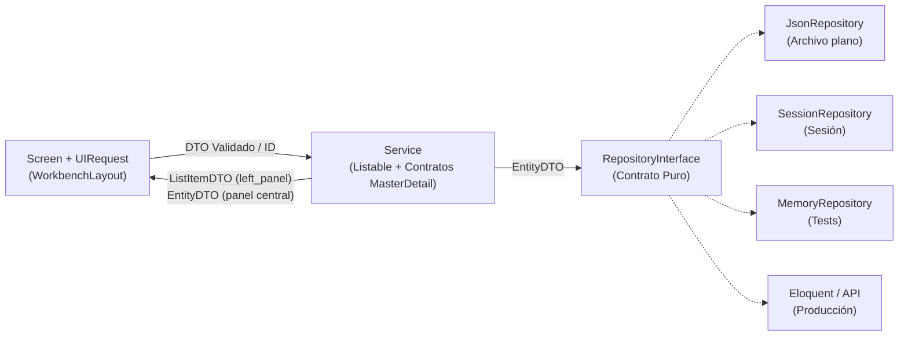

# 🗂️ Master-Detail CRUD Guide & Getting Started (`usim:crud`)

USIM v2.24.0 incorpora generación de pantallas **Master-Detail orientadas a capacidades** mediante `php artisan usim:crud`, diseñadas bajo **Clean Architecture**, **SOLID** y **100% desacopladas de Eloquent**.

En lugar de acoplar la UI a tablas SQL, el flujo se organiza en tres capas limpias comunicadas por **DTOs inmutables**:



* **Panel Izquierdo (`slots.left_panel`):** Renderiza un `ItemList` buscable (`selection_mode: single`) alimentado por `Listable::list()`, más el botón `+ Nuevo` cuando el servicio soporta creación.
* **Barra Contextual (`slots.top_bar`):** Muestra dinámicamente el estado actual (*Editando: X*, *Detalle: X* o *Nuevo registro*) y el botón `Eliminar` con `ConfirmDialog` cuando el servicio soporta borrado.
* **Panel Central (`main`):** Alterna automáticamente entre un **Empty State** claro y el formulario de **Edición Directa** (o vista de solo lectura), soportando campos escalares, relaciones `1:N` (`Select`) y relaciones `M:N` (`ItemList` múltiple buscable).

---

## 🚀 Getting Started: Tu primer Master-Detail en 2 minutos

Tienes dos formas de empezar: **prototipando todo el stack con datos mock** (sin base de datos) o **conectando un Service existente**.

### Camino A: Prototipado instantáneo desde cero (Mock en JSON o Sesión)

Si quieres levantar una pantalla funcional inmediatamente sin escribir migraciones ni modelos Eloquent, usa `--with-stack=json` (o `session` / `memory`):

```bash
php artisan usim:crud Catalog/ProductManager \
  --with-stack=json \
  --fields="sku:string,name:string,price:float,active:bool,notes:text?" \
  --discover
```

**¿Qué acaba de ocurrir?**
1. Se creó el DTO inmutable `app/DTOs/Catalog/ProductDTO.php`.
2. Se creó el contrato puro `app/Contracts/Repositories/Catalog/ProductRepositoryInterface.php`.
3. Se creó el repositorio `app/Repositories/Catalog/JsonProductRepository.php` con 3 registros semilla autogenerados en `storage/app/usim/products.json`.
4. Se creó `app/Services/Catalog/ProductService.php` implementando `Listable`, `Detailable`, `CreatableDetail`, `UpdatableDetail` y `DeletableDetail`.
5. Se crearon la `Screen` (`ProductManager.php`), su layout declarativo (`product-manager.layout.yaml`), el `UIRequest` (`SaveProductManagerRequest.php` con `toDto()`), los archivos `lang/{es,en}` y el test funcional en Pest (`tests/Feature/Catalog/ProductManagerScreenTest.php`).
6. `usim:discover` registró la pantalla y ya puedes visitarla en `/catalog/product-manager`.

> **Tip de Inyección de Dependencias:** Cuando pases de prototipo a producción, crea `EloquentProductRepository implements ProductRepositoryInterface` y enlázalo en `AppServiceProvider`:
> ```php
> $this->app->bind(
>     \App\Contracts\Repositories\Catalog\ProductRepositoryInterface::class,
>     \App\Repositories\Catalog\JsonProductRepository::class, // Cambiar por EloquentProductRepository::class en prod
> );
> ```
> **No tendrás que modificar ni una sola línea de `ProductService` ni de `ProductManager`.**

---

### Camino B: Generar desde un Service + DTO predefinidos (con relaciones `1:N` y `M:N`)

Supongamos que ya cuentas con servicios `BrandService` (`Listable`) y `TagService` (`Listable`), y deseas construir un gestor de productos con relaciones `1:N` (Marca) y `M:N` (Etiquetas).

#### Paso 1: Define tu DTO con atributos de relación

```php
<?php

declare(strict_types=1);

namespace App\DTOs\Catalog;

use App\Services\Catalog\BrandService;
use App\Services\Catalog\TagService;
use Idei\Usim\Attributes\Crud\BelongsTo;
use Idei\Usim\Attributes\Crud\BelongsToMany;
use Idei\Usim\Attributes\Crud\CrudField;

final readonly class ProductDTO
{
    /**
     * @param  list<int|string>  $tagIds
     */
    public function __construct(
        public int|string|null $id,
        public string $sku,
        public string $name,
        public float $price,
        public bool $active = true,
        #[CrudField(type: 'textarea')]
        public ?string $notes = null,
        #[BelongsTo(BrandService::class)]
        public int|string|null $brandId = null,
        #[BelongsToMany(TagService::class)]
        public array $tagIds = [],
    ) {}
}
```

#### Paso 2: Implementa las capacidades deseadas en tu `Service`

```php
<?php

declare(strict_types=1);

namespace App\Services\Catalog;

use App\Contracts\Repositories\Catalog\ProductRepositoryInterface;
use App\DTOs\Catalog\ProductDTO;
use Idei\Usim\Contracts\ItemList\Listable;
use Idei\Usim\Contracts\MasterDetail\CreatableDetail;
use Idei\Usim\Contracts\MasterDetail\DeletableDetail;
use Idei\Usim\Contracts\MasterDetail\Detailable;
use Idei\Usim\Contracts\MasterDetail\UpdatableDetail;
use Idei\Usim\DTOs\ListItemDTO;
use Idei\Usim\Enums\Style;
use Illuminate\Support\Collection;

/**
 * @implements Detailable<ProductDTO>
 * @implements CreatableDetail<ProductDTO>
 * @implements UpdatableDetail<ProductDTO>
 */
class ProductService implements CreatableDetail, DeletableDetail, Detailable, Listable, UpdatableDetail
{
    public function __construct(
        protected ProductRepositoryInterface $repository,
    ) {}

    public function list(string $search = '', array $context = []): Collection
    {
        // Proyecta ProductDTO -> ListItemDTO para el ItemList del panel izquierdo
        return collect($this->repository->all())
            ->map(fn (ProductDTO $p): ListItemDTO => ListItemDTO::make(
                id: $p->id ?? 0,
                label: "{$p->name} ({$p->sku})",
                subtitle: '$'.number_format($p->price, 2),
                badge: $p->active ? 'Activo' : 'Inactivo',
                badgeStyle: $p->active ? Style::SUCCESS : Style::SECONDARY,
            ))
            ->filter(fn (ListItemDTO $item): bool => $search === '' || str_contains(mb_strtolower($item->label), mb_strtolower($search)))
            ->values();
    }

    public function findDetail(int|string $id): ?ProductDTO
    {
        return $this->repository->find($id);
    }

    public function createDetail(object $dto): ProductDTO
    {
        assert($dto instanceof ProductDTO);

        return $this->repository->create($dto);
    }

    public function updateDetail(int|string $id, object $dto): ?ProductDTO
    {
        assert($dto instanceof ProductDTO);

        return $this->repository->update($id, $dto);
    }

    public function deleteDetail(int|string $id): bool
    {
        return $this->repository->delete($id);
    }
}
```

#### Paso 3: Ejecuta `usim:crud` apuntando al Service

```bash
php artisan usim:crud Catalog/ProductManager --service=Catalog/ProductService --discover
```

El comando inspecciona `ProductService` y `ProductDTO` mediante Reflexión (sin que debas pasar `--fields`):
* Genera `sel_brand_id` (`Select`) inyectando `BrandService` y cargando sus opciones automáticamente.
* Genera `lst_tag_ids` (`ItemList` en modo `multiple`, buscable y con `keep_selected_visible: true`) conectado a `TagService`.
* Genera `SaveProductManagerRequest` con reglas de validación, mapeo automático de errores a cada componente visual y `toDto($id): ProductDTO`.

---

## 🔍 Capacidades Graduales (Desde Explorador Read-Only hasta CRUD Completo)

`usim:crud` adapta el código generado según las interfaces que implemente tu `Service` (**Principio de Segregación de Interfaces - ISP**):

| Interfaces implementadas en el `Service` | Resultado generado |
|---|---|
| `Listable` + `Detailable` | **Explorador Master-Detail de Solo Lectura** (`screen_readonly.php.stub`): sin `UIRequest`, sin botones *Nuevo/Guardar/Eliminar*, campos marcados `readonly`/`disabled`. Ideal para auditoría, logs o catálogos de consulta. |
| `+ UpdatableDetail` | Activa edición directa en el panel central (`Guardar cambios` / `Restablecer`) + `UIRequest`. |
| `+ CreatableDetail` | Añade botón `+ Nuevo` en la cabecera del `left_panel` y CTA en el *Empty State*. |
| `+ DeletableDetail` | Añade botón contextual `Eliminar` en `slots.top_bar` con modal `ConfirmDialog` y retorno limpio al *Empty State*. |

> **Importante:** Para pantallas Master-Detail utiliza los contratos de `Idei\Usim\Contracts\MasterDetail\*` (`CreatableDetail`, `UpdatableDetail`, `DeletableDetail`) en lugar de `Idei\Usim\Contracts\ItemList\Creatable|Updatable`. Estos últimos están diseñados para edición rápida *inline* de una sola línea dentro del propio `ItemList`.

---

## 🏷️ Referencia de Atributos en el DTO y DSL de `--fields`

### Atributos PHP en DTOs (`Idei\Usim\Attributes\Crud\*`)

* `#[BelongsTo(RelatedService::class, searchable: true)]`: Relación `1:N`. Genera `sel_<prop>` (`Select`).
* `#[BelongsToMany(RelatedService::class, searchable: true, maxHeight: 240)]`: Relación `M:N`. Genera `lst_<prop>` (`ItemList` con `selection_mode: multiple`).
* `#[CrudField(type: 'textarea'|'email'|'number'|'password'|'checkbox'|'text', rules: '...', span: 1|2, readonly: false, ignore: false)]`: Ajusta widget, reglas de validación de Laravel, ancho de columna en el grid central (`1` o `2`), modo solo lectura o exclusión del formulario (`ignore: true`).

### Sintaxis rápida de `--fields` (para `--with-stack`)

| Expresión | Tipo en DTO | Componente generado |
|---|---|---|
| `name:string` | `string` | `Input` (`type: text`, `required`) |
| `contactEmail:email` | `string` | `Input` (`type: email`, regla `email`) |
| `notes:text?` | `?string = null` | `Textarea` (`span: 2`, `nullable`) |
| `stock:int` / `price:float` | `int` / `float` | `Input` (`type: number`, `integer`/`numeric`) |
| `active:bool` | `bool = true` | `Checkbox` |
| `brandId:one(Catalog/BrandService)` | `int\|string\|null = null` | `Select` (`#[BelongsTo]`) |
| `tagIds:many(Catalog/TagService)` | `array = []` | `ItemList` múltiple (`#[BelongsToMany]`) |

---

## 🎨 Personalización de Stubs (`vendor:publish`)

Si tu equipo desea personalizar la estructura o estética de los archivos generados por `usim:crud` (por ejemplo, cambiar el ancho del `left_panel`, mover botones o añadir cabeceras corporativas):

```bash
# Publicar únicamente los stubs de CRUD en stubs/usim/crud/
php artisan vendor:publish --tag=usim-crud-stubs

# O publicar todos los stubs de scaffolding (screen, request, crud) en stubs/usim/
php artisan vendor:publish --tag=usim-stubs
```

### Resolución en cascada archivo por archivo (Sin *Stub Drift*)
`BaseScaffoldCommand` resuelve cada `.stub` de forma individual:
1. Busca primero en `stubs/usim/crud/<archivo>.stub`.
2. Si no existe localmente, utiliza el stub oficial incluido en `packages/idei/usim/stubs/scaffolding/crud/`.

**Buena práctica:** Tras publicar `--tag=usim-crud-stubs`, **conserva en `stubs/usim/crud/` únicamente los archivos que hayas modificado** (por ejemplo `screen.layout.yaml.stub`) y elimina el resto. Así seguirás recibiendo mejoras automáticas del paquete en las demás plantillas. Si en una ejecución puntual deseas ignorar tus stubs locales, pasa `--package-stubs`.

---

## 🛠️ Opciones completas del comando

```bash
php artisan usim:crud [name]
  --service=          # Clase del Service existente (FQCN o relativa a App\Services)
  --with-stack=       # Genera DTO + RepositoryInterface + MockRepo + Service (json, session, memory)
  --fields=           # Campos del DTO al usar --with-stack (o override explícito)
  --layout=workbench  # Layout contenedor (workbench, default, main, none o FQCN)
  --visibility=       # Visibilidad de acceso (authenticated, public, guest)
  --no-i18n           # Omitir generación de traducciones en lang/
  --no-test           # Omitir generación del test funcional en Pest
  --package-stubs     # Ignorar overrides en stubs/usim/ y usar los stubs internos del paquete
  --discover          # Ejecutar php artisan usim:discover al finalizar
  --dry-run           # Previsualizar capacidades detectadas y rutas sin escribir archivos
  --interactive       # Forzar asistente interactivo guiado
  --force             # Sobrescribir archivos existentes
```

---

## 🧪 Testing de Pantallas Master-Detail

Cada pantalla generada incluye un test funcional en `tests/Feature/...ScreenTest.php` usando `ScreenTestHarness` (< 10 ms en memoria, sin HTTP ni base de datos si inyectas un repositorio en memoria):

```php
use App\Contracts\Repositories\Catalog\ProductRepositoryInterface;
use App\Repositories\Catalog\MemoryProductRepository;
use App\UI\Screens\Catalog\ProductManager;
use Idei\Usim\Testing\ScreenTestHarness;

it('edits a product through the master-detail flow', function (): void {
    $repo = new MemoryProductRepository;
    app()->instance(ProductRepositoryInterface::class, $repo);

    $harness = ScreenTestHarness::for(ProductManager::class)->render();

    // 1. Estado inicial vacío
    $harness->assertComponentVisible('cnt_empty_state');
    $harness->assertComponentHidden('cnt_detail_form');

    // 2. Seleccionar registro en el panel izquierdo
    $harness->call('item_selected', ['selected' => [1]]);
    $harness->assertComponentHidden('cnt_empty_state');
    $harness->assertComponentVisible('cnt_detail_form');

    // 3. Guardar cambios en edición directa
    $harness->call('save_detail', [
        'input_sku' => 'SKU-999',
        'input_name' => 'Updated Sensor',
        'input_price' => '250.00',
        'chk_active' => true,
    ]);

    expect($repo->find(1)?->sku)->toBe('SKU-999');
});
```
